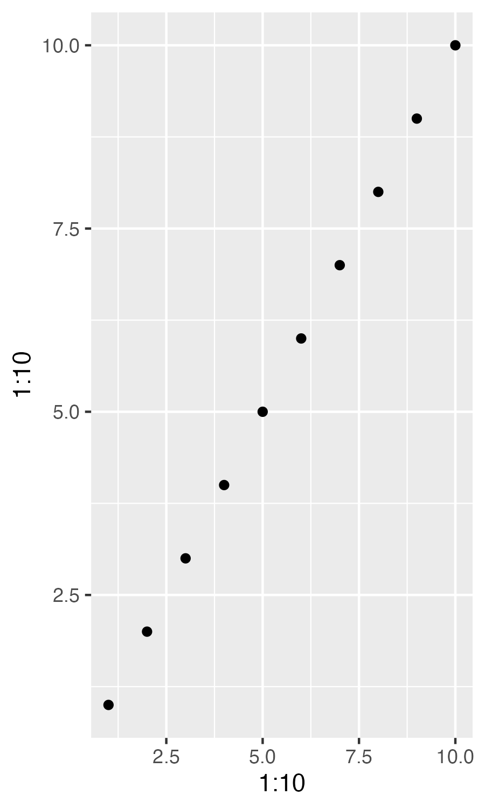

```{r setup, include=FALSE}
knitr::opts_chunk$set(echo = TRUE)
options(tidyverse.quiet = TRUE)
```


## Intro Thoughts


## Status Quo

```{r}
library(tidyverse)

```

## Experiment

```{r}
ggplot() + 
  aes(x = 1:10, y = 1:10) + 
  geom_point()

ggsave("test0.png", width = 3, height = 5)


```


```{r}
#' @export
save_and_show <- function(file = NULL, width = 6, height = 4) {

  structure(
    list(file = file, width = width, height = height), 
    class = "save_and_show"
    )

}

#' @import ggplot2
#' @importFrom ggplot2 ggplot_add
#' @export
ggplot_add.save_and_show <- function(object, plot, object_name) {
  
  plot |> ggsave(plot = _, file = object$file, width = object$width, height = object$height)
  
  knitr::include_graphics(object$file)
  
}


ggplot() + 
  aes(x = 1:10, y = 1:10) + 
  geom_point() + 
  save_and_show(file = "temp1.png", width = 2, height = 2)

```


## Closing remarks, Other Relevant Work, Caveats
