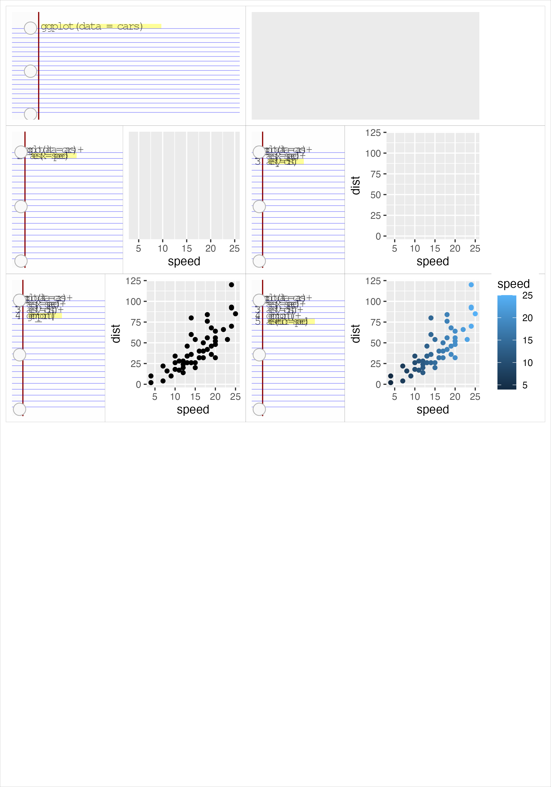

```{r setup, include=FALSE}
knitr::opts_chunk$set(echo = TRUE)
options(tidyverse.quiet = TRUE)
```


## Intro Thoughts


## Status Quo

```{r}
library(tidyverse)

gapminder_2002 <- gapminder::gapminder |> filter(year == 2002)

theme_set(

  
)


p <- ggplot(data = gapminder_2002) +  
  aes(x = gdpPercap/1000,
      y = lifeExp) +  
  geom_point() + 
  scale_x_log10()


code_eval_label <- function(x){ eval(parse(text = x)) + labs(subtitle = x) }

code008 <- 
'p + 
  ggforce::geom_voronoi_tile(normalize = T, 
                             color = "darkgrey",
                             alpha = .5) +
  aes(fill = continent, group = 1)
 '

code000 <- 'p'
code001 <- 'p + geom_hex(alpha = .5)'
code002 <- 'p + geom_hex(bins = 10, alpha = .5, color = "white")'
code003 <- 'p + ggforce::geom_mark_rect() + 
              aes(fill = continent, color = continent)'
code004 <- 'p + geom_smooth()'
code005 <- 'p + geom_smooth(method = lm)'

code006 <- 'p + geom_quantile()'
code007 <- 'p + geom_rug()'

out <- code000 |> code_eval_label(); out; out -> p_base_plot
out <- code008 |> code_eval_label(); out; out -> p_geom_voronoi_tile
out <- code001 |> code_eval_label(); out; out -> p_geom_hex
out <- code002 |> code_eval_label(); out; out -> p_geom_hex_bins_10
out <- code003 |> code_eval_label(); out; out -> p_geom_mark_rect
out <- code004 |> code_eval_label(); out; out -> p_geom_smooth
out <- code005 |> code_eval_label(); out; out -> p_geom_smooth_lm
out <- code006 |> code_eval_label(); out; out -> p_geom_quantile
out <- code007 |> code_eval_label(); out; out -> p_geom_rug

```


```{r, fig.width=30, fig.height=30}
library(patchwork)

individual_plots_theme <- theme_void(base_family = "mono", base_size = 30) + 
  theme(palette.fill.continuous = "viridis") +
  theme(plot.background = element_rect(color = "black", linewidth = .2), 
        plot.margin = margin(8,8,8,8),
        panel.background = element_rect(fill = "grey95"))

p_base_plot +
  p_geom_smooth + 
  p_geom_smooth_lm +
  p_geom_rug + 
  p_geom_quantile +
  p_geom_voronoi_tile + 
  p_geom_hex + 
  p_geom_hex_bins_10 +
  p_geom_mark_rect + 
  plot_annotation(title = "continuous x, continuous y\n", subtitle = "p <- ggplot(data = gapminder_2002) +  
  aes(x = gdpPercap/1000,
      y = lifeExp) +  
  geom_point()\n") & 
  individual_plots_theme


 d <- diamonds |> 
  ggplot() + 
  aes(carat, price) + 
  geom_point() + 
  scale_x_log10() + 
  scale_y_log10() + 
  scale_color_viridis_c()


d + ggpointdensity::geom_pointdensity()


i <- ggplot(economics) + aes(date, unemploy) + geom_point(alpha = .2) 

'i' |> code_eval_label() +
'i + geom_area()' |> code_eval_label() +
'i + geom_line()' |> code_eval_label() +
'i + geom_step(direction = "hv") + economics |> slice(1:20)' |> code_eval_label() & 
  individual_plots_theme


```

## Experiment

```{r, fig.width=30, fig.height=30}
c <- ggplot(mpg) + aes(x = hwy) + geom_rug()

'c' |> code_eval_label() +
'c + geom_area(stat = "bin")' |> code_eval_label() +
'c + geom_density(kernel = "gaussian")' |> code_eval_label() +
'c + geom_dotplot()' |> code_eval_label() +
'c + geom_freqpoly()' |> code_eval_label() +
'c + geom_histogram(color = "white")' |> code_eval_label() & 
  individual_plots_theme


f <- ggplot(mpg) + aes(x = class, y = hwy) + geom_point(alpha = .5)
'f' |> code_eval_label() +
'f + geom_col(alpha = .2, color = "white")'|> code_eval_label() +
'f + geom_boxplot()'|> code_eval_label() +
'f + geom_dotplot(binaxis = "y", 
                stackdir = "center", 
                alpha = .2)'|> code_eval_label() +
'f + geom_violin(scale = "area")'|> code_eval_label() & 
  individual_plots_theme


f <- ggplot(mpg) + aes(x = class, y = hwy) + geom_point(alpha = .5)
'f' |> code_eval_label() +
'last_plot() + geom_col(alpha = .2, color = "white")'|> code_eval_label() +
'f + geom_boxplot()'|> code_eval_label() +
'f + geom_dotplot(binaxis = "y", 
                stackdir = "center", 
                alpha = .2)'|> code_eval_label() +
'f + geom_violin(scale = "area")'|> code_eval_label() & 
  individual_plots_theme

```


```{r}
# nope... 
'ggplot(cars)' |> code_eval_label() +
'last_plot() + aes(x = speed)' |> code_eval_label() +
'last_plot() + aes(y = dist)' |> code_eval_label() +
'last_plot() + geom_point()' |> code_eval_label()


paste_collapse <- function(x){

  paste(x, collapse = "\n")  
  
}

code_ggram <- function(x){
  
  ggram::ggram(code = x, code_style_args = ggram:::specify_code_plot_style(size = .2), widths = c(1,1))
  
}

ggrams_build <- 'ggplot(data = cars) +
  aes(x = speed) + 
  aes(y = dist) + 
  geom_point() + 
  aes(color = speed) + 
  scale_color_viridis_c()
  '  |> 
  flipbookr:::code_parse() |> 
  flipbookr:::parsed_return_partial_code_sequence() |> 
  tibble(partials = _) |>
  mutate(partials_collapsed = purrr::map_chr(partials, paste_collapse)) |> 
  mutate(ggrams = purrr::map(partials_collapsed, code_ggram))
  

ggrams_build$ggrams[[1]] + 
  ggrams_build$ggrams[[2]] + 
  ggrams_build$ggrams[[3]] + 
  ggrams_build$ggrams[[4]] + 
  ggrams_build$ggrams[[5]] + 
  plot_spacer() + 
  plot_spacer() + 
  plot_spacer() + 
  plot_spacer() + 
  plot_spacer() + 
  plot_spacer()

last_plot() +
   plot_annotation(theme = theme(plot.margin = unit(c(0,0,0,0), units = "cm")))

ggsave("physical.png", width = 7, height = 10)




```


## Closing remarks, Other Relevant Work, Caveats
