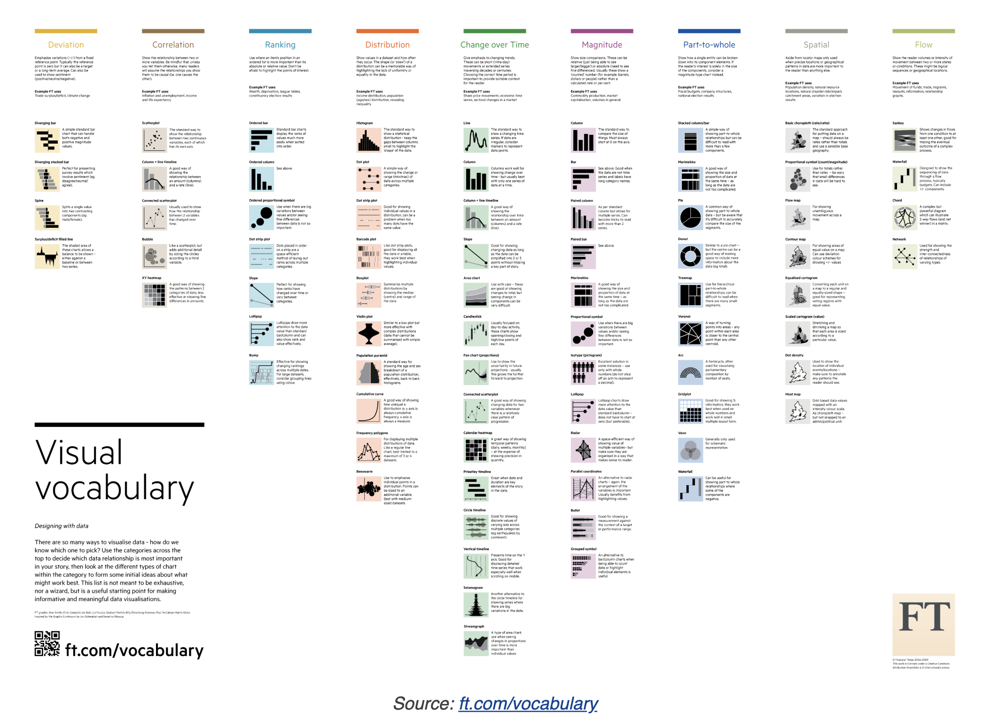
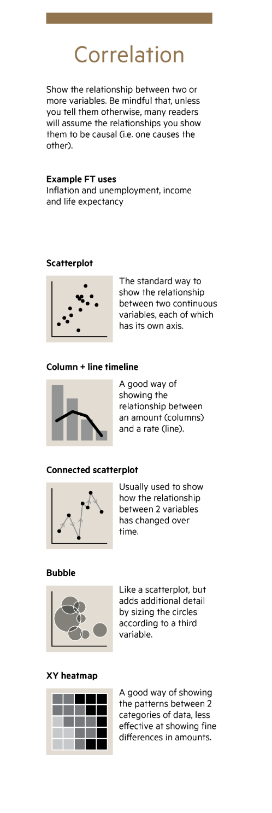
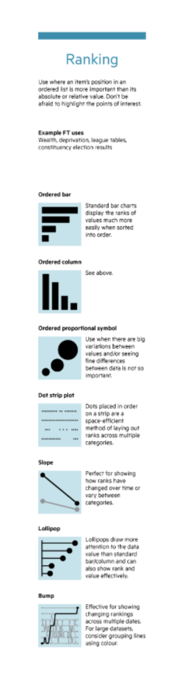
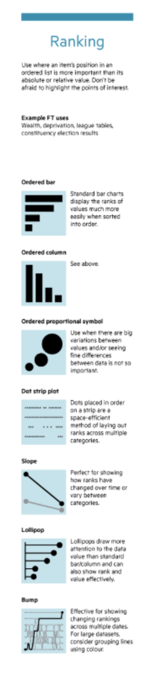
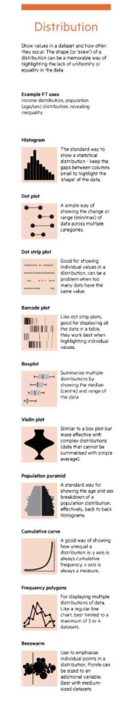

```{r setup, include=FALSE}
knitr::opts_chunk$set(echo = TRUE, dev = "ragg_png")
options(tidyverse.quiet = TRUE)

```

## Intro Thoughts



## Divergence


```{r}
library(tidyverse)
library(patchwork)
library(ggstats)

# Diverging Bar
{set.seed(12345)
  tibble(profit_losses = runif(8, -1, 1), 
       business = letters[1:8]) |> 
  ggplot() + 
  aes(x = profit_losses,
      y = business) + 
  geom_col()} /
  
# Diverging Stacked bar 
# todo: another dataset - survey, and position likert exported
{diamonds |> 
  ggplot() + 
  aes(y = color,
      fill = cut) + 
  ggstats::geom_likert() + 
  ggstats::scale_fill_likert() + 
  geom_vline(xintercept = 0, color = "grey", linetype = "dashed")} /
  
# Spine
{Titanic |> 
  data.frame() |> 
  uncount(Freq) |> 
  ggplot() + 
  aes(y = Class,
      alpha = Survived) + 
  ggstats::geom_diverging()} /
  
# Surplus/Deficit filled line
{set.seed(1212121)
tibble(profit_losses = runif(100, -1, 1),
       year = 1901:2000) |> 
  mutate(running_total = cumsum(profit_losses)) |> 
  ggplot() + 
  aes(x = year,
      y = running_total) + 
  geom_area() } /
  plot_spacer() /
  plot_spacer() / 
  plot_spacer()  /
  plot_spacer()/
  plot_spacer()/
  plot_spacer() ->
deviation


```

# Correlation: scatterplot, column-line timeline, connected scatterplot, Bubble, xy heatmap



```{r}
library(tidyverse)


# Scatter
{mtcars |> 
  ggplot() + 
  aes(x = wt, y = mpg) + 
  geom_point()}/

# column-line
  ggplot() /

# connected scatterplot
{gapminder::gapminder |> 
  filter(country == "Netherlands") |>
  ggplot() + 
  aes(x = year, y = lifeExp) + 
  geom_line(linetype = "dashed") + 
  geom_point()} /

# bubble
{gapminder::gapminder |> 
  filter(year == 2002) |> 
  mutate(pop_millions = pop/1000000) |>
  ggplot() + 
  aes(x = gdpPercap, y = lifeExp) + 
  geom_point() + 
  aes(size = pop) +
  #optional 
  scale_size(range = c(1,12)) + 
  aes(shape = I(21)) + 
  aes(color = I("white"), fill = I("grey" |> alpha(.5)))} /

# xy heatmap
{diamonds |> 
  group_by(cut, color) |> 
  summarize(mean_price = mean(price)) |> 
  ggplot() + 
  aes(y = cut, x = color) + 
  geom_tile() +
  aes(fill = mean_price) +
  # optional
  scale_fill_viridis_c()}  /
  
  plot_spacer() / 
  
  plot_spacer()  /
  plot_spacer()/
  plot_spacer()/
  plot_spacer() ->

correlation

correlation
```



# Ranking: Ordered bar, Ordered columns, Ordered Proportional Symbol, Dot Strip Plot, Slope, Lollipop, Bump



```{r}

# ordered bar
{gapminder::gapminder |> 
  filter(continent == "Americas", 
         year == 1952) |> 
  ggplot() + 
  aes(x = lifeExp, 
      y = country |> fct_reorder(lifeExp)) + 
  geom_col()} /
  
# ordered columns
{gapminder::gapminder |> 
  filter(continent == "Americas", 
         year == 1952) |> 
  ggplot() + 
  aes(y = lifeExp, 
      x = country |> fct_reorder(lifeExp)) + 
  geom_col()} /

# Ordered Proportional Symbol,  
{gapminder::gapminder |> 
  filter(continent == "Americas", 
         year == 1952) |> 
  ggplot() + 
  aes(x = lifeExp, 
      y = country |> fct_reorder(lifeExp)) + 
  geom_col() +
  geom_point(shape = "💀") + 
  aes(size = lifeExp)} /
  
  
# Dot Strip Plot, 
  ggplot() /

# Slope, 
  ggplot() /

# Lollipop, 
{gapminder::gapminder |> 
  filter(continent == "Americas", 
         year == 1952) |> 
  ggplot() + 
  aes(x = lifeExp, xend = 0,
      y = country |> fct_reorder(lifeExp),
      yend = country |> fct_reorder(lifeExp)) + 
  geom_segment() + 
  geom_point()} /

# Bump 
  ggplot() /
  plot_spacer()/
  plot_spacer()/
  plot_spacer() ->
  
ranking

```


# Distribution




```{r}
# histogram
{gapminder::gapminder |> 
  filter(year == 2002) |>
  ggplot() + 
  aes(x = lifeExp) + 
  geom_histogram()}/
# dotplot - dumbbell plot - always feels hard
{gapminder::gapminder |> 
  filter(year %in% c(2002, 2007)) |>
  select(year, lifeExp, country) |>
  pivot_wider(names_from = year, 
              values_from = lifeExp, 
              names_prefix = "lifeExp_") |>
  ggplot() +
  aes(x = lifeExp_2002, xend = lifeExp_2007) }/
# dotstrip plot
{gapminder::gapminder |> 
  filter(year == 2002) |> 
  ggplot() + 
  aes(x = lifeExp,
      y = continent) +
  geom_point()}/

# barcode plot
{gapminder::gapminder |> 
  filter(year == 2002) |> 
  ggplot() + 
  aes(x = lifeExp,
      y = continent) +
  geom_point(shape = "|", size = 4)}/
  
# boxplot
{gapminder::gapminder |> 
  filter(year == 2002) |> 
  ggplot() + 
  aes(x = lifeExp,
      y = continent) +
  geom_boxplot()}/
# violin plot
{gapminder::gapminder |> 
  filter(year == 2002) |> 
  ggplot() + 
  aes(x = lifeExp,
      y = continent) +
  geom_violin()}/
# population pyramid
{Titanic |>
  data.frame() |>
  uncount(Freq) |>
  ggplot() +
  aes(y = Class,
      fill = Survived) +
  ggstats::geom_pyramid(position = ggstats::position_diverging()) }/
# cumulative curve
{gapminder::gapminder |>
  filter(country == "China") |>
  mutate(gdp_total = cumsum(gdpPercap * pop)) |>
  ggplot() +
  aes(x = year,
      y = gdp_total) +
  geom_path()}/
# Frequency polygons
{gapminder::gapminder |>
  filter(year == 2002) |>
  ggplot() +
  aes(x = lifeExp,
      color = continent == "Asia") +
  geom_freqpoly()}/
# Beeswarm - not great
{gapminder::gapminder |> 
  filter(year == 2002) |>
  ggplot() + 
  aes(y = lifeExp,
      x = continent,
      size = pop) + 
  ggbeeswarm::geom_beeswarm()} ->
distribution

```


```{r}
ggplot() / ggplot() /ggplot() /ggplot() /ggplot()


```


```{r, fig.width=20, fig.height=30}
{deviation | correlation | ranking | distribution} +
  plot_annotation("Visual Vocabulary X ggplot2 ecosystem", 
                  theme = theme_gray(base_size = 50)) & 
  theme(legend.position = "none")


```

## Closing remarks, Other Relevant Work, Caveats
