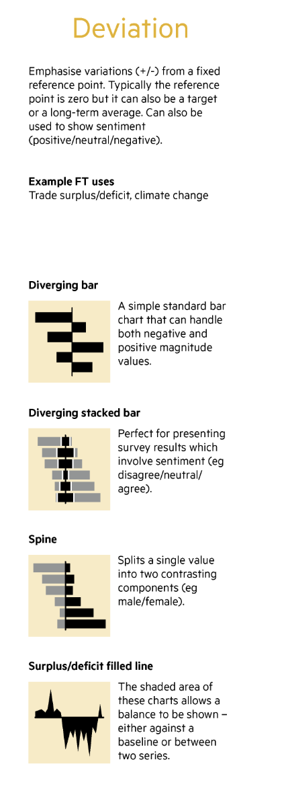

```{r setup, include=FALSE}
knitr::opts_chunk$set(echo = TRUE)
options(tidyverse.quiet = TRUE)

```

## Intro Thoughts


## Status Quo



```{r}
library(tidyverse)
# Diverging Bar
tibble(profit_losses = runif(8, -1, 1), 
       business = letters[1:8]) |> 
  ggplot() + 
  aes(x = profit_losses,
      y = business) + 
  geom_col() 

# Diverging Stacked bar 
# todo: another dataset - survey, and position likert exported
diamonds |> 
  ggplot() + 
  aes(y = color,
      fill = cut) + 
  ggstats::geom_likert(position = ggstats:::position_likert()) +  #< uh-oh not exported
  ggstats::scale_fill_likert() + 
  geom_vline(xintercept = 0, color = "grey", linetype = "dashed")


# Spine
Titanic |> 
  data.frame() |> 
  uncount(Freq) |> 
  ggplot() + 
  aes(y = Class,
      alpha = Survived) + 
  ggstats::geom_diverging(position = ggstats:::position_diverging())


# Surplus/Deficit filled line
set.seed(2027)
tibble(profit_losses = runif(100, -1, 1),
       year = 1901:2000) |> 
  mutate(running_total = cumsum(profit_losses)) |> 
  ggplot() + 
  aes(x = year,
      y = running_total) + 
  geom_area()


```


```{r}
library(tidyverse)

```

## Experiment

```{r}

```

## Closing remarks, Other Relevant Work, Caveats
