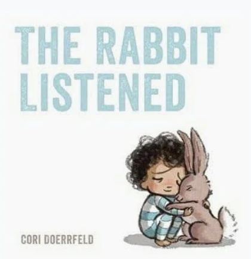
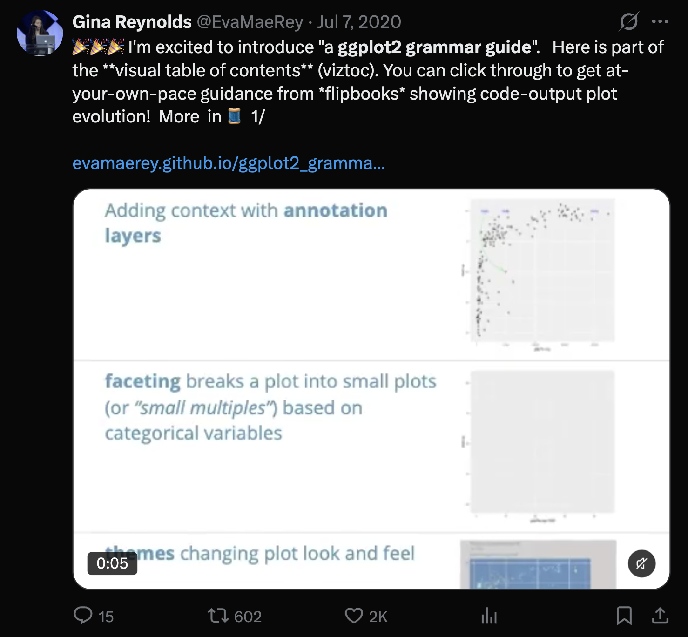
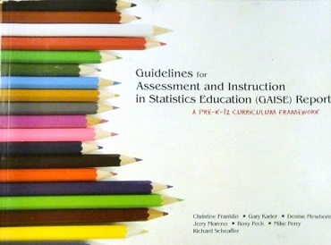
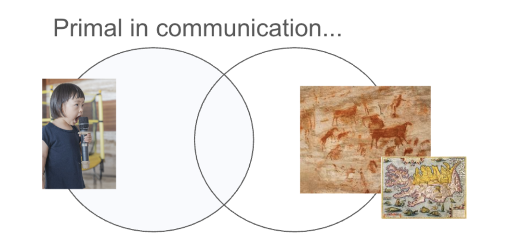
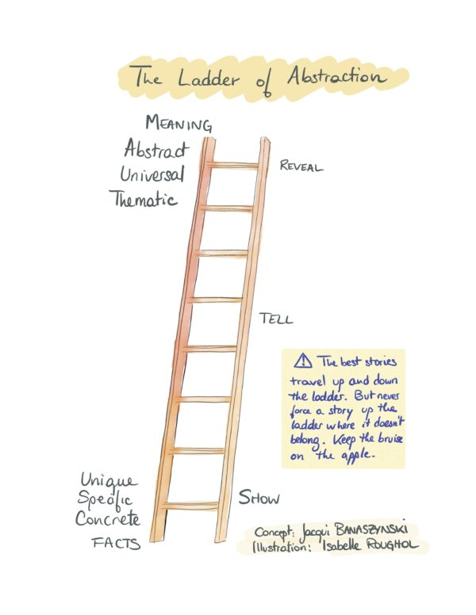
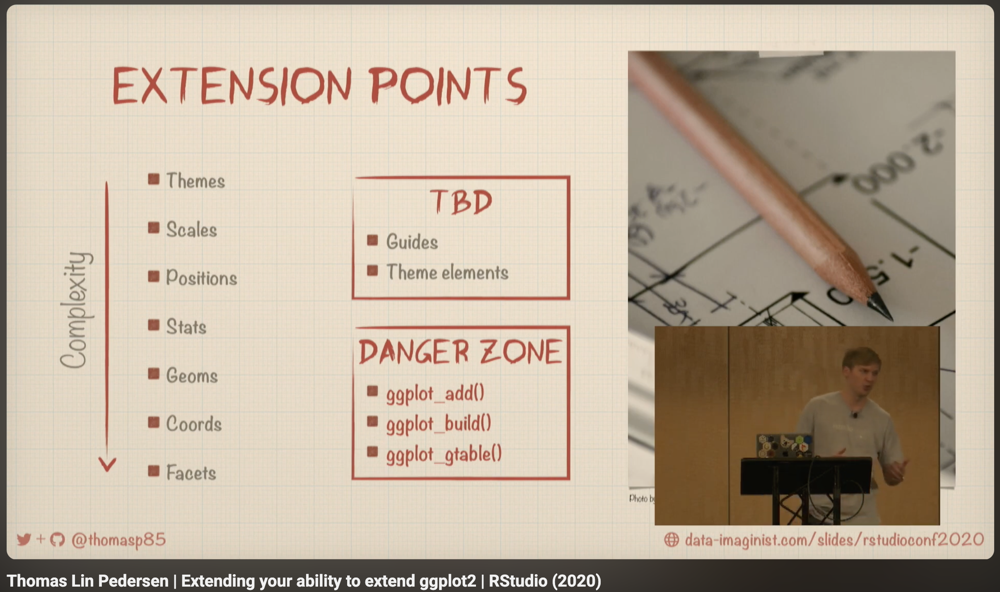
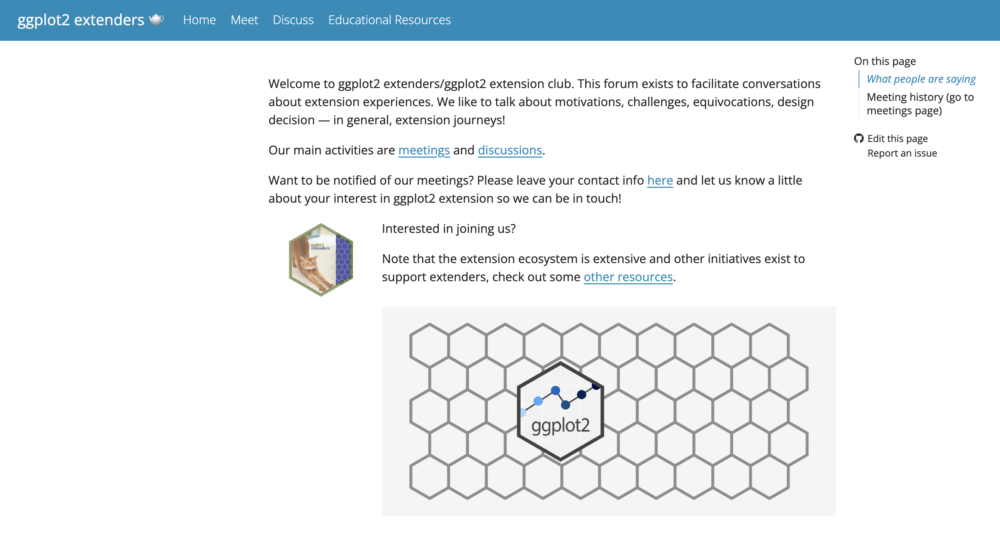

```{r, include=FALSE}
knitr::opts_chunk$set(echo = TRUE)
options(tidyverse.quiet = TRUE)
```


class: inverse, bottom
background-image: url(https://images.unsplash.com/photo-1559827260-dc66d52bef19?ixlib=rb-4.0.3&ixid=M3wxMjA3fDB8MHxwaG90by1wYWdlfHx8fGVufDB8fHx8fA%3D%3D&auto=format&fit=crop&w=1470&q=80)
background-size: cover

# .Large[viz- and vocab-first intro to stats curricula: leveraging ggplot2 extension]
## .small[gg x ISI x EAPOST]
## .small[bit.ly/gg-eapost]
#### .tiny[Dr. Evangeline Reynolds | 2026-11-20 | EAPOST webinar, Image credit: Silas Baisch, Upsplash]


???

---

Title slide
```{r, include = F}
# This is the recommended set up for flipbooks
# you might think about setting cache to TRUE as you gain practice --- building flipbooks from scratch can be time consuming
knitr::opts_chunk$set(fig.width = 6, fig.height = 4.5, message = FALSE, warning = FALSE, comment = "", cache = F)
library(flipbookr)
```



Dr. Jennifer McNally

---

Now... Adjuncting 🤞 at DU...

A little about me and teaching, viz, and programming background:

-   2018-2020 - University of Denver
-   2020-2023 - West Point
-   2023 - present back in Denver...

---

# DU 2018-2020: quantitative methodology

-   2018-2020 - University of Denver, Visiting Teaching Assistant Professor


--

## Spring 2020 'Can you teach a data viz graduate level class?' George F. DeMartino, Ilene Grabel

---

# 'A ggplot2 grammar guide':


---




---

# West Point Fall 2020-2023

-   2020-2023 - Institutional Analytics and Math Intro to Statistics and Probability Instructor, Institutional Research Data Scientist...

> The text differs from traditional texts in both content and pedagogy. Statistical inference is introduced using simulation-based methods in Chapter 1. This allows students to intuitively understand the process of inference from the very beginning of their course.

---

# A 'Cathedral of Statistics'


> 'Statistics Curricula should reveal the beautiful cathedral of Statistics.' paraphrase ... George Cobb (paraphrase)

---

# GAISE grounded

EAPOST:

'We are aiming for substantial impact on instruction in the art and practice of statistical thinking, aligned with the American Statistical Association's Guidelines for Assessment and Instruction in Statistics Education (GAISE) and current research on teaching and learning in statistics. '

<https://sites.google.com/view/eaapost/project-overview>



---

> 'Some instructors may train students in using a specific software package, but mastery of advanced programming skills should not be allowed to crowd out data analysis skills or statistical thinking.'

---


---

# But, missing gg code 😢

*"**I just don't see how a world that makes such wonderful things could be bad."***


---

Can we have it all? Vis + Code + 'not crowd out statistical thinking'...

---

## Code + viz? \| grammar + viz? \| language + viz?

Because writing things down, feels very grounding. Having verbal expression and visual expression side by side, coordinated feels like a superpower.





---


---


---

And ggplot2 has extraordinary 'write down your narrative' capabilities

---

```{r echo = F, warning=F, message=F}
library(tidyverse)
library(ggstamp) 

hans_png_path_canvas = "../2023-11-14-flipbooks-lawrence-livermore/images/hans_argument.png"
hans_png_path_y_axis = "../2023-11-14-flipbooks-lawrence-livermore/images/hans_y_axis.png"
hans_png_path_x_axis = "../2023-11-14-flipbooks-lawrence-livermore/images/hans_x_axis.png"
hans_png_path_color = "../2023-11-14-flipbooks-lawrence-livermore/images/hans_colors.png"
hans_png_path_size = "../2023-11-14-flipbooks-lawrence-livermore/images/hans_size.png"
lab <- "Rosling builds up his\ngraph bit by bit with lanugage"
```

`r chunk_reveal("hans", display_type = "output", title = "## BBC, Hans Rosling 200 years in 4 minutes")`

```{r hans, include = F}
ggplot() + 
  stamp_png(png = hans_png_path_y_axis) +
  stamp_png(png = hans_png_path_x_axis) + 
  stamp_png(png = hans_png_path_color) + 
  stamp_png(png = hans_png_path_size) + 
  stamp_label(label = lab, size = 10)
```

---


`r chunk_reveal("gapminder")`

```{r gapminder, echo = F, include=F}
gapminder::gapminder |> 
  filter(year == 2002) |> 
  ggplot() + 
  ggchalkboard:::theme_rosling() +
  aes(y = lifeExp) + 
  aes(x = gdpPercap) + 
  geom_point() + 
  aes(color = continent) + 
  aes(size = pop)
```

---

```{r, echo = F}
library(ggregions)
library(ggbrat)

lobes <- load_atlas("lobes")

lobes$atlas |> 
  mutate(region = region |> 
           str_remove("LOBE.") |> 
           str_to_sentence()) |> 
  select(region, geometry) ->
brain_lobes_ref
```

`r chunk_reveal("limbic_bliss", title = "# coordinated visual and verbal -> limbic?")`

```{r limbic_bliss, message=F, warning=F, echo = F, include = F}
library(ggregions)
set_regions(brain_lobes_ref)

ggplot() +
  stamp_region() + 
  stamp_region(keep = "Occipital",
               fill = "cornflowerblue") + 
  stamp_region(keep = "Temporal",
               fill = "coral3") +
  stamp_region(keep = "Limbic",
               fill = "goldenrod")
```

---

## ggplot2 lets us *transcribe* statistical narratives,

--

## record logic of visually conveyed ideas...

--

## our trains of thought

--

# 🤯🤯🤯🤯🤯🤯

---

### Should we reorganize our conversations into a haiku?

--

> 'Graphical Poems?' Hadley Wickham 2010 "A layered grammar of graphics'

--

```{r}
gapminder::gapminder |> 
  filter(year == 2002) |> 
  ggplot(mapping = aes(y = lifeExp, #<<
             x = gdpPercap, #<<
             color = continent, #<<
             size = pop)) + #<<
  geom_point() +
  ggchalkboard:::theme_rosling() 
```

---

'A question that I'd wanted to ask ... was about this syntax...'

```{r}
ggplot(cars) + 
   aes(x = dist) + #<<
   geom_histogram()
```

--

> 'Does it still make you cringe?  Or don't care anymore? To me, ggplot2's overlooked superpower (but I find myself still self conscious about using it). '

---

> 'I still don't like it :)' - Hadley Wickham, creator of ggplot2, July 2026

---

ggplot2 excels in:

--

# Temporal

--

# Fidelity

--

## process preserving... 

--

## conversation recording

--

## idea tracing


---


## The magic is in the conversation... 🗣️🗣️

---

But... ISI - a *cathedral of statistics*...

--

*base* ggplot2, while conversational, is not enough...

---

`r chunk_reveal("linear_modeling", title = "Linear model w/ base ggplot")`

```{r linear_modeling, include = F}
ggplot(mtcars) + 
  aes(wt, mpg) + 
  geom_point() + 
  geom_smooth(method = lm) +
  stat_smooth(method = lm, 
              geom = "point", 
              xseq = mtcars$wt,
              color = "blue") + 
  geom_smooth(method = lm, 
              formula = y ~ 1)
```

---

Not GAISE compliant ... 'software should not crowd out statistical thinking'...

---

And *not* as low of a level that you might need in a statistics class room....





Linguist S.I. Hayakawa in 1939: "Language in Action." New York: Harcourt, Brace.

Where you have to connect all the ideas, and go from raw data to abstract ideas and inferential assertions. Base ggplot2 and extension I'd run across hadn't made these linkages, as *is* done by ISI book & applets —

Cobb: 'For most students, their noses stay too close to the canvas, they only see *disconnected* details. '

ggplot2 & extensions 2020 ladders with missing rungs for stats educators.


---

# No.

# Logical.

# Leaps.


---

# No.

# Missing. 

# Rungs.


---



---

> 'Extending `ggplot2` [using ggproto extension points] is not for the faint-hearted.'

---


- 2022-Present - Community Organizer, co-founder: ggplot2 extenders meetup



---

Education... Easy geom recipes...

---

```{r setup, include=FALSE}
knitr::opts_chunk$set(echo = TRUE, dev = "ragg_png")
options(tidyverse.quiet = TRUE)
```


# Finally, main topic... gg extension X ISI X EAPOST?

-   ggprop.test <https://github.com/EvaMaeRey/ggprop.test>
-   ggt.test <https://evamaerey.github.io/ggt.test/>
-   ggxmeans <https://github.com/EvaMaeRey/ggxmean>

--


<https://evamaerey.github.io/mytidytuesday/2026-05-04-ggttest-ggram/intro-stats-narrative.html>


---

`r chunk_reveal("dolphin", eval = F)`

```{r dolphin, warning=F, message=F}
library(tidyverse)
library(ggprop.test)

dolphin_data |> 
  ggplot() + 
  labs(title = "Do Doris and Buzz Communicate 🐬🐬🐟🪣?") +
  aes(x = observed) + 
  geom_stack() + 
  geom_stack_label() + 
  geom_support() +
  geom_prop() + 
  geom_prop_label() + 
  stamp_prop(.5) + 
  stamp_prop_label(.5) + 
  geom_binomial_null(.5)
```


---

`r chunk_reveal("organs", eval = F)`


```{r organs, include=F}
donor_data |> 
  ggplot() + 
  labs(title = "Organ donation🫀🫁responses like coin flips?") +
  aes(x = decision) + 
  geom_stack() + 
  geom_stack_label() + 
  geom_support() +
  geom_prop() + 
  geom_prop_label() + 
  stamp_prop(.5) + 
  stamp_prop_label(.5) + 
  geom_binomial_null(.5) 
```


---

r chunk_reveal("dolphin_simulation")`


```{r dolphin_simulation, include = F}
p <- dolphin_data |> 
  ggplot() + 
  labs(title = "Do Doris and Buzz Communicate 🐬🐬🐟🪣?") +
  aes(x = observed) + 
  geom_stack() + 
  geom_stack_label() + 
  geom_support() +
  geom_prop() + 
  geom_prop_label() 

p + 
  labs(title = "What's consistent with 16 coin flips? \n🪙🪙🪙🪙🪙🪙🪙🪙🪙🪙🪙🪙🪙🪙🪙🪙") +
  dolphin_data |> mutate(observed = to_synthetic(observed)) +
  dolphin_data |> mutate(observed = to_synthetic(observed)) +
  dolphin_data |> mutate(observed = to_synthetic(observed)) + 
  dolphin_data |> mutate(observed = to_synthetic(observed)) +
  dolphin_data |> mutate(observed = to_synthetic(observed)) +
  dolphin_data |> mutate(observed = to_synthetic(observed)) + 
  dolphin_data |> mutate(observed = to_synthetic(observed)) +
  dolphin_data |> mutate(observed = to_synthetic(observed)) +
  dolphin_data |> mutate(observed = to_synthetic(observed)) 
```


---

`r chunk_reveal("ttest", include = F, title = "## t test")`

```{r ttest}
# remotes::install_github("EvaMaeRey/ggt.test")
library(ggt.test)

data_grit_undergrad |>
  ggplot() + 
  labs(title = "As Gritty on average as West Point Cadets? 💪🪖🧗") +  
  aes(score) + 
  geom_rug() + 
  geom_stacks() + 
  geom_support() +
  geom_mean() + 
  geom_mean_label() + 
  stamp_mean(3.75)  + 
  geom_tdist_null(3.75)
```


---

`r chunk_reveal("haircuts", include = F, title = "## Difference in means")`


```{r haircuts, include = F}
data_haircuts |>
  ggplot() + 
  labs(title = "Are haircut price averages different for men v. women") +
  aes(x = price) + 
  geom_support() + 
  geom_rug() + 
  geom_stacks() +
  geom_mean() + 
  geom_mean_label() + 
  facet_align(sex) + 
  geom_mean_diff() + 
  geom_mean_diff_label()
```


---

`r chunk_reveal("linearmodel", include = F, title = "## linear model")`


```{r linearmodel, include = F}
library(ggxmean)

mtcars |>
  ggplot() + 
  labs(title = "Does weigt predict milage? 🚙🚕🏎️") +
  aes(x = wt) +
  geom_rug() +
  aes(y = mpg) +
  geom_point() +
  geom_lm() + 
  geom_lm_fitted() + 
  geom_lm_residuals() + 
  geom_lm_conf_int() + 
  geom_lm_formula() + 
  geom_lm_intercept() + 
  geom_lm_intercept_label(hjust = 0)
```

---

https://github.com/arthurwelle/codehover/

```{r, eval = F}
{dolphin_data |> 
  ggplot() + 
  labs(title = "Do Doris and Buzz Communicate 🐬🐬🐟🪣?") +
  aes(x = observed) + 
  geom_stack() + 
  geom_stack_label() + 
  geom_support() +
  geom_prop() + 
  geom_prop_label() + 
  stamp_prop(.5) + 
  stamp_prop_label(.5) + 
  geom_binomial_null(.5)} |>
  codehover::ch_hover()  #<<  in-script reveal - student - usable?
```


---

```{r, echo = F}
{dolphin_data |> 
  ggplot() + 
  labs(title = "Do Doris and Buzz Communicate 🐬🐬🐟🪣?") +
  aes(x = observed) + 
  geom_stack() + 
  geom_stack_label() + 
  geom_support() +
  geom_prop() + 
  geom_prop_label() + 
  stamp_prop(.5) + 
  stamp_prop_label(.5) + 
  geom_binomial_null(.5)} |>
  codehover::ch_hover()
```


---
class: inverse, center, middle


# Thank you!


```{r}
knitr::knit_exit()

```

```{r, eval = F}
library(tidyverse)

paste_collapse <- function(x){

  paste(x, collapse = "\n")  
  
}

code_ggram <- function(x, ...){
  
  ggram::ggram(code = x, code_style_args = ggram:::specify_code_plot_style(size = 1.5))
  
}

theme_set(theme_gray(base_size = 5))

library(ggt.test)


{ggrams_build <- 'ggplot(data_grit_undergrad) + 
  labs(title = "As Gritty on average as West Point Cadets? 💪🪖🧗") +  
  aes(score) + 
  geom_rug() + 
  geom_stacks() + 
  geom_support() +
  geom_mean() + 
  geom_mean_label() + 
  stamp_mean(3.75)  + 
  geom_tdist_null(3.75)'  |> 
  flipbookr:::code_parse() |> 
  flipbookr:::parsed_return_partial_code_sequence() |> 
  tibble(partials = _) |>
  mutate(partials_collapsed = purrr::map_chr(partials, paste_collapse)) |> 
  mutate(ggrams = purrr::map(partials_collapsed, code_ggram))}
  
# ggrams_build$ggrams[[1]] + 
#   ggrams_build$ggrams[[2]] + 
#   ggrams_build$ggrams[[3]] + 
#   ggrams_build$ggrams[[4]] + 
#   ggrams_build$ggrams[[5]] + 
#   plot_spacer() + 
#   plot_spacer() + 
#   plot_spacer() + 
#   plot_spacer() + 
#   plot_spacer() + 
#   plot_spacer()


cowplot::plot_grid(plotlist = ggrams_build$ggrams, ncol = 2)


ggsave("out.png", width = 7, height = 13)

library(tidyverse)
library(ggt.test)
theme_set(theme_gray(6))


'ggplot(data_grit_undergrad) + 
  labs(title = "As Gritty on average as West Point Cadets? 💪🪖🧗") +  
  aes(score) + 
  geom_rug() + 
  geom_stacks() + 
  geom_support() +
  geom_mean() + 
  geom_mean_label() + 
  stamp_mean(3.75)' |>
  ggram:::ggstoryboard()

ggsave("out.png", width = 7, height = 10)


'ggplot(tribble(~region,
        "Temporal",
        "Limbic",
        "Occipital") ) +
  stamp_region(fill = "white") + 
  aes(region = region, 
      fill = region) + 
  geom_region() + 
  stamp_region(keep = "Limbic",
               fill = "gold") + 
  labs(title = "Limbic bliss")' |>
  ggram:::ggstoryboard()

ggsave("out.png", width = 7, height = 10)


'ggplot(tribble(~region,
        "Temporal",
        "Limbic",
        "Occipital") ) +
  stamp_region(fill = "white") + 
  aes(region = region, 
      fill = region) + 
  geom_region() + 
  stamp_region(keep = "Limbic",
               fill = "gold") + 
  labs(title = "Limbic bliss")' |>
  ggram:::ggram()


library(ggcube)

"ggplot(mountain) + 
  aes(x = x) + 
  aes(y = y) + 
  coord_3d() + 
  aes(z = z) + 
  geom_surface_3d() + 
  ggplyr::layers_wipe() + 
  geom_contour_3d(fill = 'white', color = 'black')" |> 
  ggram:::ggstoryboard()


ggsave("out.png", width = 7, height = 10)


library(ggcube)
mammoth <- data.frame(do.call(rbind, rjson::fromJSON(
      file = paste0("https://raw.githubusercontent.com/PAIR-code/",
                    "understanding-umap/master/raw_data/mammoth_3d_50k.json")
)))
colnames(mammoth) <- c("Y", "X", "Z")

ggplot(mammoth, 
       aes(X, Y, Z)) +
      geom_hull_3d(method = "alpha", radius = 8, fill = "red") +
      light(direction = c(-1, 1, 0),
             shadow = 1, highlight = 1
             ) +
      coord_3d(roll = -90, scales = "fixed", 
               panels = "zmin", expand = FALSE) +
      theme(axis.text = element_blank(),
            axis.ticks = element_blank(),
            axis.title = element_blank())

library(ggcube)

sphere <- function(x0 = 0, ...) {
      ggcube:::geom_isofunction_3d(fun = function(x, y, z) (x - x0)^2 + y^2 + z^2 - 1,
                          xlim = x0 + c(-1.1, 1.1), ylim = c(-1.1, 1.1), zlim = c(-1.1, 1.1),
                          n = 40, ...)
}

ggplot() +
      coord_3d(scales = "fixed") +
      scale_fill_viridis_c() +
      theme_dark() +
      theme(legend.position = "none") +
      
      # apply shading to solid fill, with a specular highlight for shininess
      sphere(fill = "#8a2900",
             light = light("hard", specular = 1, specular_size = 10)) +
      
      # apply shading to aesthetic fill
      sphere(x0 = 2.5, mapping = aes(fill = after_stat(x)),
             light = light(direction = c(0, -1, 0), anchor = "scene")) +
      
      # map surface orientation to 3D RGB color channels
      sphere(x0 = 5, light = light(tone = "normals", direction = c(1, 0, -1), anchor = "scene"))


library(ggcube)
library(tidyverse)

gyroid <- function(x, y, z) sin(x) * cos(y) + sin(y) * cos(z) + sin(z) * cos(x)
'ggplot() +
   coord_3d() + 
   geom_isofunction_3d(
            fun = gyroid, cap = TRUE, fill = "grey", n = 60,
            xlim = c(0, 4 * pi), ylim = c(0, 4 * pi), zlim = c(0, 4 * pi)) +
  theme_void() +
  light(highlight = .8, shadow = 1) + 
  coord_3d(yaw = -40) + 
  coord_3d(yaw = -50) + 
  coord_3d(yaw = -60) + 
  coord_3d(yaw = -70)' |>
  ggram:::ggstoryboard()

```
