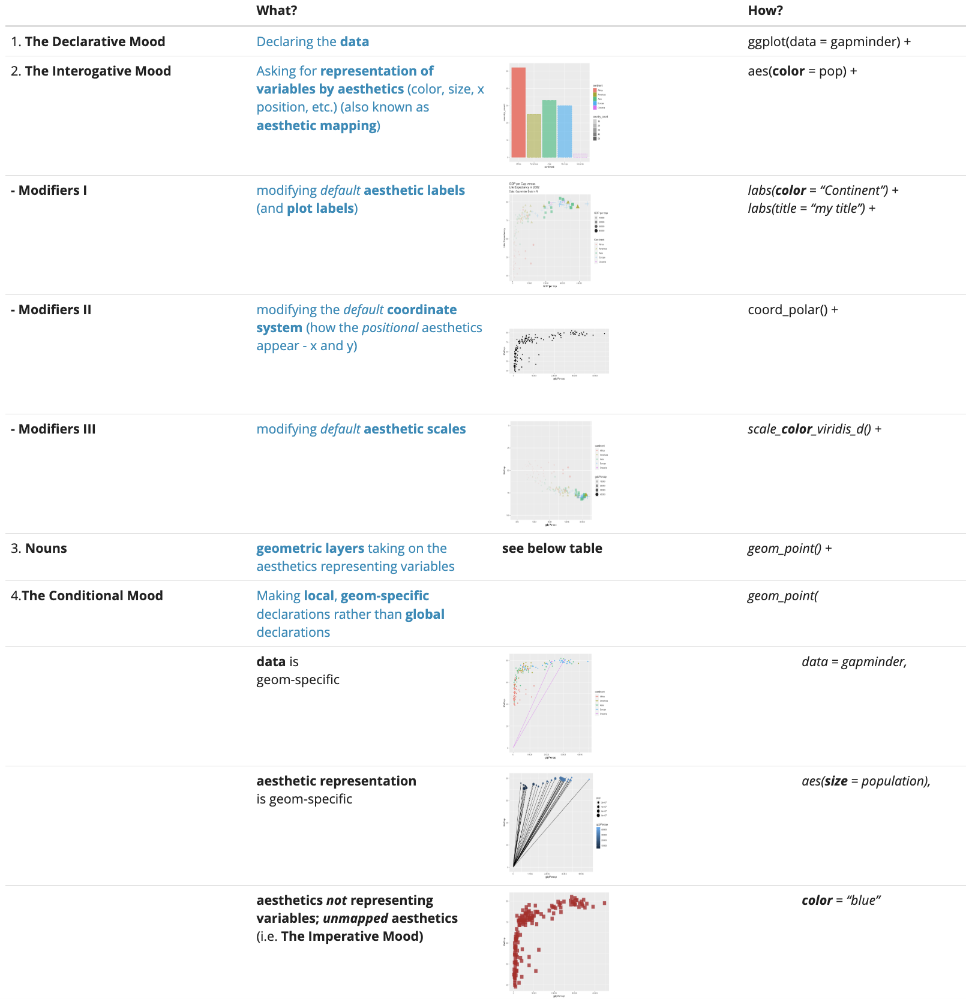
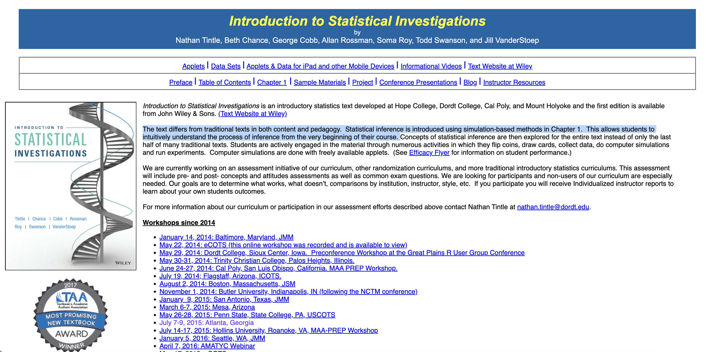
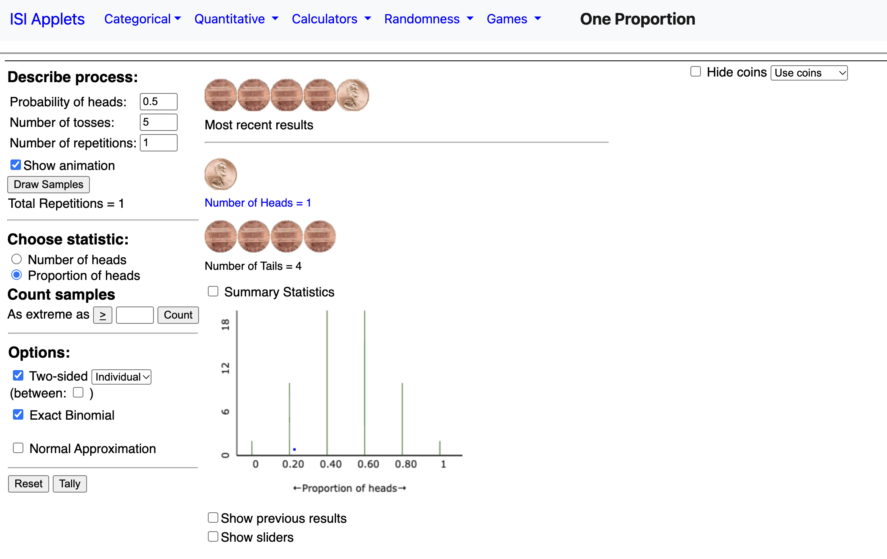
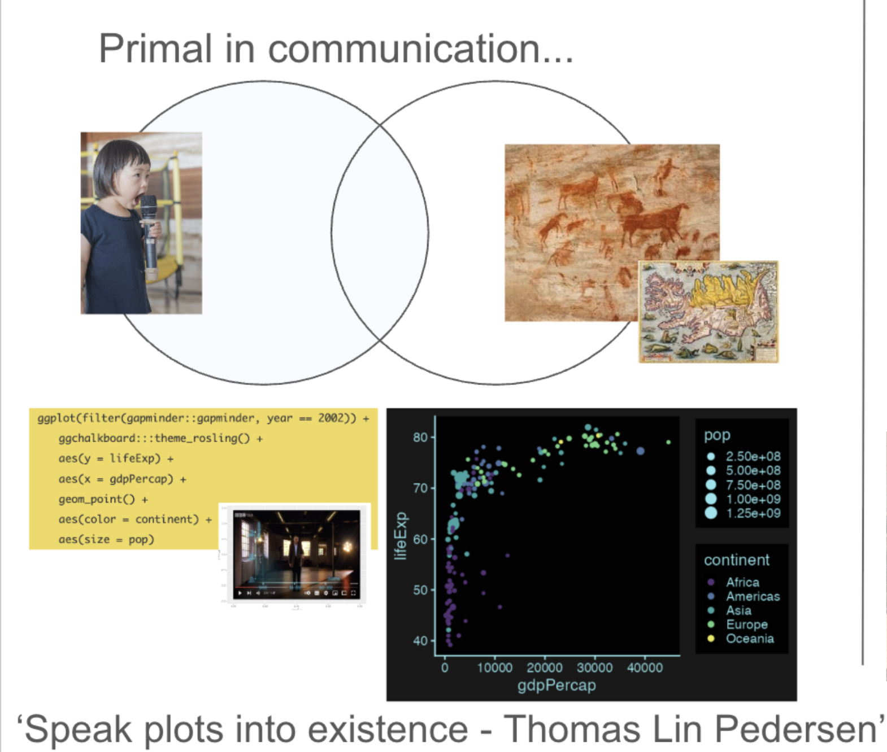

Now... Adjuncting 🤞 at DU...

A little about me and teaching, viz, and programming background:

-   2018-2020 - University of Denver
-   2020-2023 - West Point
-   2023 - present back in Denver...

---

-   2018-2020 - University of Denver, Visiting Teaching Assistant Professor

'Can you teach a data viz graduate level class?'  George F. DeMartino, Ilene Grabel

--

'A ggplot2 grammar guide':




---

-   2020-2023 - Institutional Analytics and Math Intro to Statistics and Probability Instructor, Institutional Research Data Scientist...

> The text differs from traditional texts in both content and pedagogy. Statistical inference is introduced using simulation-based methods in Chapter 1. This allows students to intuitively understand the process of inference from the very beginning of their course.



> 'Statistics Curricula should reveal the beautiful cathedral of Statistics.' paraphrase ... George Cobb (paraphrase)

---

Grounded in ...


---

> 'Some instructors may train students in using a specific software package, but mastery of advanced programming skills should not be allowed to crowd out data analysis skills or statistical thinking.'



---

*"**I just don't see how a world that makes such wonderful things could be bad."***


---

Can we have it all? Vis + Code + 'not crowd out statistical thinking'...

---

Because writing things down, feels very grounding. Having verbal expression and visual expression side by side feels like a superpower.



And ggplot2 has extraordinary 'write-down-narrative' capabilities

Hans...

Descriptive statistics...

```{r echo = F, warning=F, message=F}
library(tidyverse)
library(ggstamp) 

hans_png_path_canvas = "../2023-11-14-flipbooks-lawrence-livermore/images/hans_argument.png"
hans_png_path_y_axis = "../2023-11-14-flipbooks-lawrence-livermore/images/hans_y_axis.png"
hans_png_path_x_axis = "../2023-11-14-flipbooks-lawrence-livermore/images/hans_x_axis.png"
hans_png_path_color = "../2023-11-14-flipbooks-lawrence-livermore/images/hans_colors.png"
hans_png_path_size = "../2023-11-14-flipbooks-lawrence-livermore/images/hans_size.png"
lab <- "Rosling gives full voice\nto aesthetic mappings"

{ggplot() + 
  stamp_png(png = hans_png_path_y_axis) +
  stamp_png(png = hans_png_path_x_axis) + 
  stamp_png(png = hans_png_path_color) + 
  stamp_png(png = hans_png_path_size) + 
  stamp_label(label = lab, size = 10)} |> 
  codehover::ch_hover()
```


<https://www.youtube.com/watch?v=jbkSRLYSojo&t=37s>

```{r gapminder, echo = F}
{gapminder::gapminder |> 
  filter(year == 2002) |> 
  ggplot() + 
  ggchalkboard:::theme_rosling() +
  aes(y = lifeExp) + 
  aes(x = gdpPercap) + 
  geom_point() + 
  aes(color = continent) + 
  aes(size = pop)} |> 
  codehover::ch_hover()
```

---

ggplot2 lets us *transcribe* statistical narratives, 
--
visual logic, 
--
our trains of thought 


---

Reorg as a haiku?

```{r}
gapminder::gapminder |> 
  filter(year == 2002) |> 
  ggplot(aes(y = lifeExp, 
             x = gdpPercap, 
             color = continent, 
             size = pop) ) + 
  geom_point() +
  ggchalkboard:::theme_rosling() 
```

So much is lost...


> Temporal fidelity

process preserving... 


---

A question that I'd wanted to ask ... was about this syntax...

```{r}
ggplot(cars) + 
   aes(x = dist) + 
   geom_histogram()
```


Does it still make you cringe?  Or don't care anymore?  To me, ggplot2's overlooked superpower (but I find myself still self conscious about using it).  

---

I still don't like it :)


---

limbic bliss

```{r}

library(ggregions)
library(ggbrat)

lobes <- load_atlas("lobes")

lobes$atlas |> 
  mutate(region = region |> 
           str_remove("LOBE.") |> 
           str_to_sentence()) |> 
  select(region, geometry) ->
brain_lobes_ref

set_regions(brain_lobes_ref)

tribble(~region,
        "Temporal",
        "Limbic",
        "Occipital")  |> 
  ggplot() +
  stamp_region() + 
  aes(region = region, 
      fill = region) + 
  geom_region() + 
  stamp_region(keep = "Limbic",
               fill = "gold") + 
  labs(title = "Limbic bliss")

```


'write-down-\*statistical\*-narrative' capabilities

And also some statistical tools....

---

But *not* as low of a level that you might need in a statistics class room....


Linguist S.I. Hayakawa in 1939: "Language in Action." New York: Harcourt, Brace.

Where you have to connect all the ideas, and go from raw data to abstract ideas and inferential assertions. Base ggplot2 and extension I'd run across hadn't made these linkages, as *is* done by ISI book & applets —

Cobb: 'For most students, their noses stay too close to the canvas, they only see *disconnected* details. '

ggplot2 & extensions 2020 ladders with missing rungs for stats educators.

---

But: 'not crowd out statistical thinking'...

---


---

-   2022-Present - Community Organizer, co-founder: ggplot2 extenders meetup


---

> 'Extending `ggplot2` [using ggproto extension points] is not for the faint-hearted.'

-   Easy Geom Recipes...

EAPOST:

'We are aiming for substantial impact on instruction in the art and practice of statistical thinking, aligned with the American Statistical Association's Guidelines for Assessment and Instruction in Statistics Education (GAISE) and current research on teaching and learning in statistics. '

<https://sites.google.com/view/eaapost/project-overview>

------------------------------------------------------------------------

> 'Some instructors may train students in using a specific software package, but mastery of advanced programming skills should not be allowed to crowd out data analysis skills or statistical thinking.'

------------------------------------------------------------------------

```{r setup, include=FALSE}
knitr::opts_chunk$set(echo = TRUE, dev = "ragg_png")
options(tidyverse.quiet = TRUE)
```

Thank you.

------------------------------------------------------------------------

A little about me and teaching, viz, and programming background:

-   2018-2020 - University of Denver
-   2020-2023 - Institutional analytics and Math Intro to Statistics and Probability Instructor
-   2022-Present - Community Organizer, founder: ggplot2 extenders meetup

------------------------------------------------------------------------

Start at the end:

-   ggprop.test
-   ggt.test
-   ggxmeans

```{r, eval = F, echo = F}
library(tidyverse)
flows_df <- tibble::tribble(~outflows, ~inflows, ~amount,
                    "USA",  "USA", 40,
                    "USA",  "China", 50,
                    "USA", "Germany", 30,
                    "China",  "USA", 60,
                    "China", "Germany", 25,
                    "Germany",  "USA", 35)

{flows_df |>
ggplot() +
aes(source = outflows, target = inflows, freq = 1) +
ggchord2::geom_chord_diagram() +
aes(fill = outflows) +
aes(freq = amount) +
aes(fill = outflows == "China") +
ggt.test::scale_fill_logical() +
labs(title = "Flows *from* China are a big part of the picture") +
aes(fill = outflows == "USA") +
labs(title = "Flows *from* and within the USA are greater than the US's inflows") +
aes(fill = to == "Germany") +
labs(title = "Flows *to* Germany are greater than the flows from Germany")} |>
  codehover::ch_hover()


```

<https://evamaerey.github.io/mytidytuesday/2026-05-04-ggttest-ggram/intro-stats-narrative.html>

```{r, warning=F, message=F}
library(tidyverse)

# remotes::install_github("EvaMaeRey/ggprop.test")
library(ggprop.test)
library(ggchalkboard)


{dolphin_data |> 
  ggplot() + 
  labs(title = "Do Doris and Buzz Communicate 🐬🐬🐟🪣?") +
  aes(x = observed) + 
  geom_stack() + 
  geom_stack_label() + 
  geom_support() +
  geom_prop() + 
  geom_prop_label() + 
  stamp_prop(.5) + 
  stamp_prop_label(.5) + 
  geom_binomial_null(.5) } |> 
codehover::ch_hover()

p <- dolphin_data |> 
  ggplot() + 
  labs(title = "Do Doris and Buzz Communicate 🐬🐬🐟🪣?") +
  aes(x = observed) + 
  geom_stack() + 
  geom_stack_label() + 
  geom_support() +
  geom_prop() + 
  geom_prop_label() 

{ p + 
  labs(title = "What's consistent with 16 coin flips? \n🪙🪙🪙🪙🪙🪙🪙🪙🪙🪙🪙🪙🪙🪙🪙🪙") +
  dolphin_data |> mutate(observed = to_synthetic(observed)) +
  dolphin_data |> mutate(observed = to_synthetic(observed)) +
  dolphin_data |> mutate(observed = to_synthetic(observed)) + 
  dolphin_data |> mutate(observed = to_synthetic(observed)) +
  dolphin_data |> mutate(observed = to_synthetic(observed)) +
  dolphin_data |> mutate(observed = to_synthetic(observed)) + 
  dolphin_data |> mutate(observed = to_synthetic(observed)) +
  dolphin_data |> mutate(observed = to_synthetic(observed)) +
  dolphin_data |> mutate(observed = to_synthetic(observed)) 
} |>
  codehover::ch_hover()


{donor_data |> 
  ggplot() + 
  labs(title = "Organ donation🫀🫁responses like coin flips?") +
  aes(x = decision) + 
  geom_stack() + 
  geom_stack_label() + 
  geom_support() +
  geom_prop() + 
  geom_prop_label() + 
  stamp_prop(.5) + 
  stamp_prop_label(.5) + 
  geom_binomial_null(.5) } |> 
codehover::ch_hover()


# remotes::install_github("EvaMaeRey/ggt.test")
library(ggt.test)

{data_grit_undergrad |>
  ggplot() + 
  labs(title = "As Gritty on average as West Point Cadets? 💪🪖🧗") +  
  aes(score) + 
  geom_rug() + 
  geom_stacks() + 
  geom_support() +
  geom_mean() + 
  geom_mean_label() + 
  stamp_mean(3.75)  + 
  geom_tdist_null(3.75)
}

data_haircuts |>
  ggplot() + 
  labs(title = "Are haircut price averages different for men v. women") +
  aes(x = price) + 
  geom_support() + 
  geom_rug() + 
  geom_stacks()+
  geom_mean() + 
  geom_mean_label() + 
  facet_align(sex) + 
  geom_mean_diff() + 
  geom_mean_diff_label()


```
