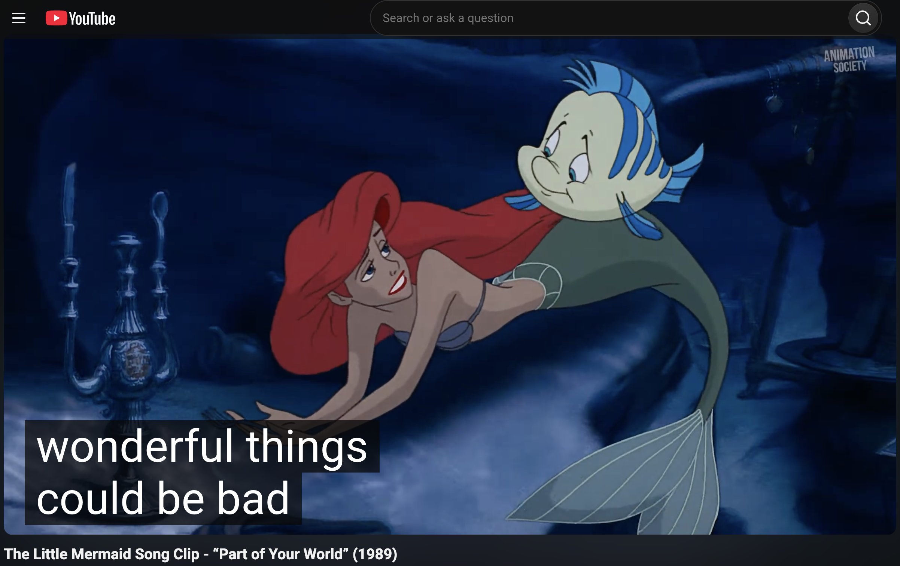
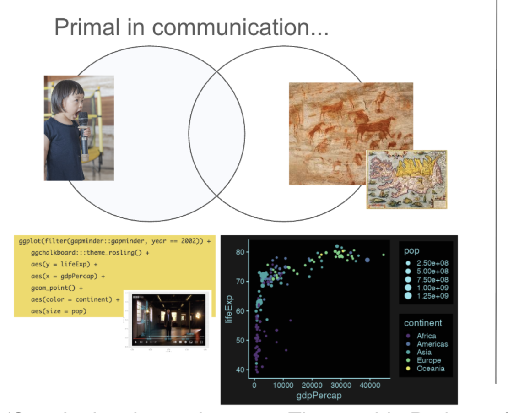

Now... Adjuncting 🤞 at DU...

A little about me and teaching, viz, and programming background:

-   2018-2020 - University of Denver
-   2020-2023 - West Point
-   2023 - present back in Denver...

------------------------------------------------------------------------

# DU 2018-2020: quantitative methodology

-   2018-2020 - University of Denver, Visiting Teaching Assistant Professor

Spring 2020 'Can you teach a data viz graduate level class?' George F. DeMartino, Ilene Grabel

--

# 'A ggplot2 grammar guide':


------------------------------------------------------------------------

# West Point 2020-2023

-   2020-2023 - Institutional Analytics and Math Intro to Statistics and Probability Instructor, Institutional Research Data Scientist...

> The text differs from traditional texts in both content and pedagogy. Statistical inference is introduced using simulation-based methods in Chapter 1. This allows students to intuitively understand the process of inference from the very beginning of their course.

------------------------------------------------------------------------

# A 'Cathedral of Statistics'


> 'Statistics Curricula should reveal the beautiful cathedral of Statistics.' paraphrase ... George Cobb (paraphrase)

------------------------------------------------------------------------

# GAISE grounding

EAPOST:

'We are aiming for substantial impact on instruction in the art and practice of statistical thinking, aligned with the American Statistical Association's Guidelines for Assessment and Instruction in Statistics Education (GAISE) and current research on teaching and learning in statistics. '

<https://sites.google.com/view/eaapost/project-overview>


------------------------------------------------------------------------

> 'Some instructors may train students in using a specific software package, but mastery of advanced programming skills should not be allowed to crowd out data analysis skills or statistical thinking.'

------------------------------------------------------------------------


------------------------------------------------------------------------

# But, missing gg code 😢

*"**I just don't see how a world that makes such wonderful things could be bad."***



------------------------------------------------------------------------

Can we have it all? Vis + Code + 'not crowd out statistical thinking'...

------------------------------------------------------------------------

# Code + viz? \| grammar + viz? \| language + viz?

Because writing things down, feels very grounding. Having verbal expression and visual expression side by side feels like a superpower.


---



---


And ggplot2 has extraordinary 'write-down-narrative' capabilities

```{r echo = F, warning=F, message=F}
library(tidyverse)
library(ggstamp) 

hans_png_path_canvas = "../2023-11-14-flipbooks-lawrence-livermore/images/hans_argument.png"
hans_png_path_y_axis = "../2023-11-14-flipbooks-lawrence-livermore/images/hans_y_axis.png"
hans_png_path_x_axis = "../2023-11-14-flipbooks-lawrence-livermore/images/hans_x_axis.png"
hans_png_path_color = "../2023-11-14-flipbooks-lawrence-livermore/images/hans_colors.png"
hans_png_path_size = "../2023-11-14-flipbooks-lawrence-livermore/images/hans_size.png"
lab <- "Rosling builds up his\ngraph bit by bit with lanugage"

{ggplot() + 
  stamp_png(png = hans_png_path_y_axis) +
  stamp_png(png = hans_png_path_x_axis) + 
  stamp_png(png = hans_png_path_color) + 
  stamp_png(png = hans_png_path_size) + 
  stamp_label(label = lab, size = 10)} |> 
  codehover::ch_hover()
```

<https://www.youtube.com/watch?v=jbkSRLYSojo&t=37s>

```{r gapminder, echo = F}
{gapminder::gapminder |> 
  filter(year == 2002) |> 
  ggplot() + 
  ggchalkboard:::theme_rosling() +
  aes(y = lifeExp) + 
  aes(x = gdpPercap) + 
  geom_point() + 
  aes(color = continent) + 
  aes(size = pop)} |> 
  codehover::ch_hover()
```

------------------------------------------------------------------------

# *Limbic* bliss

```{r, echo = F}
library(ggregions)
library(ggbrat)

lobes <- load_atlas("lobes")

lobes$atlas |> 
  mutate(region = region |> 
           str_remove("LOBE.") |> 
           str_to_sentence()) |> 
  select(region, geometry) ->
brain_lobes_ref
```

```{r, message=F, warning=F}
set_regions(brain_lobes_ref)

{tribble(~region,
        "Temporal",
        "Limbic",
        "Occipital")  |> 
  ggplot() +
  stamp_region() + 
  stamp_region(keep = "Occipital",
               fill = "cornflowerblue") + 
  stamp_region(keep = "Temporal",
               fill = "coral3") +
  stamp_region(keep = "Limbic",
               fill = "goldenrod")} |>
  codehover::ch_hover()
```

------------------------------------------------------------------------

## ggplot2 lets us *transcribe* statistical narratives,

## record logic of visually conveigned ideas ,

our trains of thought

------------------------------------------------------------------------

# 'Graphical Poems?' Reorg as a haiku?

```{r}
gapminder::gapminder |> 
  filter(year == 2002) |> 
  ggplot(aes(y = lifeExp, 
             x = gdpPercap, 
             color = continent, 
             size = pop)) + 
  geom_point() +
  ggchalkboard:::theme_rosling() 
```

------------------------------------------------------------------------

'A question that I'd wanted to ask ... was about this syntax...'

```{r}
ggplot(cars) + 
   aes(x = dist) + #<<
   geom_histogram()
```

--

'Does it still make you cringe?\
Or don't care anymore? To me, ggplot2's overlooked superpower (but I find myself still self conscious about using it). '

------------------------------------------------------------------------

'I still don't like it :)' - Hadley Wickham, creator of ggplot2

------------------------------------------------------------------------

# Temporal.

# Fidelity.

process preserving...

--

conversation recording

--

idea tracing

------------------------------------------------------------------------

'write-down-\*statistical\*-narrative' capabilities

And also some statistical tools....

```{r}
ggplot(mtcars) + 
  aes(wt, mpg) + 
  geom_point() + 
  geom_smooth(method = lm)
```

```{r}
{ggplot(mtcars) + 
  aes(wt, mpg) + 
  geom_point() + 
  geom_smooth(method = lm) + 
  stat_smooth(method = lm, 
              geom = "point", 
              xseq = mtcars$wt,
              color = "blue") + 
  geom_smooth(method = lm, 
              formula = y ~ 1)} |>
  codehover::ch_hover()
```

------------------------------------------------------------------------

But *not* as low of a level that you might need in a statistics class room....


Linguist S.I. Hayakawa in 1939: "Language in Action." New York: Harcourt, Brace.

Where you have to connect all the ideas, and go from raw data to abstract ideas and inferential assertions. Base ggplot2 and extension I'd run across hadn't made these linkages, as *is* done by ISI book & applets —

Cobb: 'For most students, their noses stay too close to the canvas, they only see *disconnected* details. '

ggplot2 & extensions 2020 ladders with missing rungs for stats educators.

> No.

> Logical.

> Leaps.

------------------------------------------------------------------------

But: 'not crowd out statistical thinking'...

------------------------------------------------------------------------


------------------------------------------------------------------------

-   2022-Present - Community Organizer, co-founder: ggplot2 extenders meetup


------------------------------------------------------------------------

> 'Extending `ggplot2` [using ggproto extension points] is not for the faint-hearted.'

-   Easy Geom Recipes...

------------------------------------------------------------------------

> 'Some instructors may train students in using a specific software package, but mastery of advanced programming skills should not be allowed to crowd out data analysis skills or statistical thinking.'

------------------------------------------------------------------------

```{r setup, include=FALSE}
knitr::opts_chunk$set(echo = TRUE, dev = "ragg_png")
options(tidyverse.quiet = TRUE)
```

-   ggprop.test <https://github.com/EvaMaeRey/ggprop.test>
-   ggt.test <https://evamaerey.github.io/ggt.test/>
-   ggxmeans <https://github.com/EvaMaeRey/ggxmean>

<https://evamaerey.github.io/mytidytuesday/2026-05-04-ggttest-ggram/intro-stats-narrative.html>

```{r, warning=F, message=F}
library(tidyverse)

# remotes::install_github("EvaMaeRey/ggprop.test")
library(ggprop.test)
library(ggchalkboard)


{dolphin_data |> 
  ggplot() + 
  labs(title = "Do Doris and Buzz Communicate 🐬🐬🐟🪣?") +
  aes(x = observed) + 
  geom_stack() + 
  geom_stack_label() + 
  geom_support() +
  geom_prop() + 
  geom_prop_label() + 
  stamp_prop(.5) + 
  stamp_prop_label(.5) + 
  geom_binomial_null(.5) } |> 
codehover::ch_hover()

p <- dolphin_data |> 
  ggplot() + 
  labs(title = "Do Doris and Buzz Communicate 🐬🐬🐟🪣?") +
  aes(x = observed) + 
  geom_stack() + 
  geom_stack_label() + 
  geom_support() +
  geom_prop() + 
  geom_prop_label() 

{ p + 
  labs(title = "What's consistent with 16 coin flips? \n🪙🪙🪙🪙🪙🪙🪙🪙🪙🪙🪙🪙🪙🪙🪙🪙") +
  dolphin_data |> mutate(observed = to_synthetic(observed)) +
  dolphin_data |> mutate(observed = to_synthetic(observed)) +
  dolphin_data |> mutate(observed = to_synthetic(observed)) + 
  dolphin_data |> mutate(observed = to_synthetic(observed)) +
  dolphin_data |> mutate(observed = to_synthetic(observed)) +
  dolphin_data |> mutate(observed = to_synthetic(observed)) + 
  dolphin_data |> mutate(observed = to_synthetic(observed)) +
  dolphin_data |> mutate(observed = to_synthetic(observed)) +
  dolphin_data |> mutate(observed = to_synthetic(observed)) 
} |>
  codehover::ch_hover()


{donor_data |> 
  ggplot() + 
  labs(title = "Organ donation🫀🫁responses like coin flips?") +
  aes(x = decision) + 
  geom_stack() + 
  geom_stack_label() + 
  geom_support() +
  geom_prop() + 
  geom_prop_label() + 
  stamp_prop(.5) + 
  stamp_prop_label(.5) + 
  geom_binomial_null(.5) } |> 
codehover::ch_hover()


# remotes::install_github("EvaMaeRey/ggt.test")
library(ggt.test)

{data_grit_undergrad |>
  ggplot() + 
  labs(title = "As Gritty on average as West Point Cadets? 💪🪖🧗") +  
  aes(score) + 
  geom_rug() + 
  geom_stacks() + 
  geom_support() +
  geom_mean() + 
  geom_mean_label() + 
  stamp_mean(3.75)  + 
  geom_tdist_null(3.75)
}

data_haircuts |>
  ggplot() + 
  labs(title = "Are haircut price averages different for men v. women") +
  aes(x = price) + 
  geom_support() + 
  geom_rug() + 
  geom_stacks()+
  geom_mean() + 
  geom_mean_label() + 
  facet_align(sex) + 
  geom_mean_diff() + 
  geom_mean_diff_label()
```

```{r, eval = F}
library(tidyverse)

paste_collapse <- function(x){

  paste(x, collapse = "\n")  
  
}

code_ggram <- function(x, ...){
  
  ggram::ggram(code = x, code_style_args = ggram:::specify_code_plot_style(size = 1.5))
  
}

theme_set(theme_gray(base_size = 5))

library(ggt.test)


{ggrams_build <- 'ggplot(data_grit_undergrad) + 
  labs(title = "As Gritty on average as West Point Cadets? 💪🪖🧗") +  
  aes(score) + 
  geom_rug() + 
  geom_stacks() + 
  geom_support() +
  geom_mean() + 
  geom_mean_label() + 
  stamp_mean(3.75)  + 
  geom_tdist_null(3.75)'  |> 
  flipbookr:::code_parse() |> 
  flipbookr:::parsed_return_partial_code_sequence() |> 
  tibble(partials = _) |>
  mutate(partials_collapsed = purrr::map_chr(partials, paste_collapse)) |> 
  mutate(ggrams = purrr::map(partials_collapsed, code_ggram))}
  
# ggrams_build$ggrams[[1]] + 
#   ggrams_build$ggrams[[2]] + 
#   ggrams_build$ggrams[[3]] + 
#   ggrams_build$ggrams[[4]] + 
#   ggrams_build$ggrams[[5]] + 
#   plot_spacer() + 
#   plot_spacer() + 
#   plot_spacer() + 
#   plot_spacer() + 
#   plot_spacer() + 
#   plot_spacer()


cowplot::plot_grid(plotlist = ggrams_build$ggrams, ncol = 2)


ggsave("out.png", width = 7, height = 13)

library(tidyverse)
library(ggt.test)
theme_set(theme_gray(6))


'ggplot(data_grit_undergrad) + 
  labs(title = "As Gritty on average as West Point Cadets? 💪🪖🧗") +  
  aes(score) + 
  geom_rug() + 
  geom_stacks() + 
  geom_support() +
  geom_mean() + 
  geom_mean_label() + 
  stamp_mean(3.75)' |>
  ggram:::ggstoryboard()

ggsave("out.png", width = 7, height = 10)


'ggplot(tribble(~region,
        "Temporal",
        "Limbic",
        "Occipital") ) +
  stamp_region(fill = "white") + 
  aes(region = region, 
      fill = region) + 
  geom_region() + 
  stamp_region(keep = "Limbic",
               fill = "gold") + 
  labs(title = "Limbic bliss")' |>
  ggram:::ggstoryboard()

ggsave("out.png", width = 7, height = 10)


'ggplot(tribble(~region,
        "Temporal",
        "Limbic",
        "Occipital") ) +
  stamp_region(fill = "white") + 
  aes(region = region, 
      fill = region) + 
  geom_region() + 
  stamp_region(keep = "Limbic",
               fill = "gold") + 
  labs(title = "Limbic bliss")' |>
  ggram:::ggram()


library(ggcube)

"ggplot(mountain) + 
  aes(x = x) + 
  aes(y = y) + 
  coord_3d() + 
  aes(z = z) + 
  geom_surface_3d() + 
  ggplyr::layers_wipe() + 
  geom_contour_3d(fill = 'white', color = 'black')" |> 
  ggram:::ggstoryboard()


ggsave("out.png", width = 7, height = 10)


library(ggcube)
mammoth <- data.frame(do.call(rbind, rjson::fromJSON(
      file = paste0("https://raw.githubusercontent.com/PAIR-code/",
                    "understanding-umap/master/raw_data/mammoth_3d_50k.json")
)))
colnames(mammoth) <- c("Y", "X", "Z")

ggplot(mammoth, 
       aes(X, Y, Z)) +
      geom_hull_3d(method = "alpha", radius = 8, fill = "red") +
      light(direction = c(-1, 1, 0),
             shadow = 1, highlight = 1
             ) +
      coord_3d(roll = -90, scales = "fixed", 
               panels = "zmin", expand = FALSE) +
      theme(axis.text = element_blank(),
            axis.ticks = element_blank(),
            axis.title = element_blank())

library(ggcube)

sphere <- function(x0 = 0, ...) {
      ggcube:::geom_isofunction_3d(fun = function(x, y, z) (x - x0)^2 + y^2 + z^2 - 1,
                          xlim = x0 + c(-1.1, 1.1), ylim = c(-1.1, 1.1), zlim = c(-1.1, 1.1),
                          n = 40, ...)
}

ggplot() +
      coord_3d(scales = "fixed") +
      scale_fill_viridis_c() +
      theme_dark() +
      theme(legend.position = "none") +
      
      # apply shading to solid fill, with a specular highlight for shininess
      sphere(fill = "#8a2900",
             light = light("hard", specular = 1, specular_size = 10)) +
      
      # apply shading to aesthetic fill
      sphere(x0 = 2.5, mapping = aes(fill = after_stat(x)),
             light = light(direction = c(0, -1, 0), anchor = "scene")) +
      
      # map surface orientation to 3D RGB color channels
      sphere(x0 = 5, light = light(tone = "normals", direction = c(1, 0, -1), anchor = "scene"))


library(ggcube)
library(tidyverse)

gyroid <- function(x, y, z) sin(x) * cos(y) + sin(y) * cos(z) + sin(z) * cos(x)
'ggplot() +
   coord_3d() + 
   geom_isofunction_3d(
            fun = gyroid, cap = TRUE, fill = "grey", n = 60,
            xlim = c(0, 4 * pi), ylim = c(0, 4 * pi), zlim = c(0, 4 * pi)) +
  theme_void() +
  light(highlight = .8, shadow = 1) + 
  coord_3d(yaw = -40) + 
  coord_3d(yaw = -50) + 
  coord_3d(yaw = -60) + 
  coord_3d(yaw = -70)' |>
  ggram:::ggstoryboard()

```
